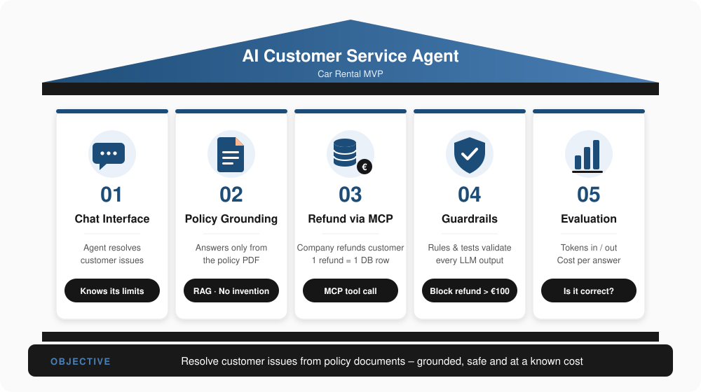
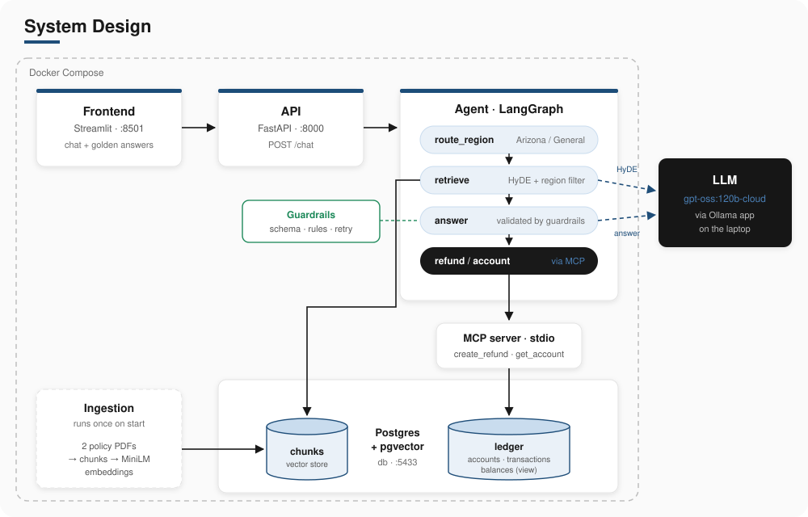

# Car Rental AI Agent – MVP

| # | Section |
|---|---------|
| 01 | [Business Requirements](#01_business-requirements) |
| 02 | [System Design](#02_system-design) |
| 03 | [Folder Structure](#03_folder-structure) |
| – | [Run the app](#run-the-app) |

---

## 01_Business Requirements

<p align="left">
  
</p>

---

## 02_System Design

<p align="left">
  
</p>

| Step | What happens | Where |
|------|--------------|-------|
| 1 | The customer asks in the chat | Frontend → API `POST /chat` |
| 2 | The region is found in the question (Arizona, otherwise General) | `route_region` |
| 3 | The LLM writes a hypothetical policy passage; its vector finds the 4 closest chunks of that region | `retrieve` (HyDE) |
| 4 | The LLM answers from these chunks only; guardrails check schema and rules, retry once, then fall back safely | `answer` |
| 5 | For a refund or an account question, the graph calls the MCP server, which writes or reads the ledger | `refund` / `account` |
| 6 | Answer, region, pages, tokens and cost go back to the chat | API → Frontend |

The LLM only proposes an action. Guardrails validate it, the graph executes it, and every number about money comes from the ledger, never from the LLM.

---

## 03_Folder Structure

| Folder / file | Purpose | Concept |
|---------------|---------|---------|
| `00_assets/` | Visuals, policy PDFs (`documents/`), golden answers (`evaluation/golden_answers.csv`) | Ground truth |
| `01_database/init.sql` | Ledger and Vector Database | Data Storage |
| `02_mcp_server/mcp_server.py` | Tools `create_refund` (writes) and `get_account` (reads) | Tool Calling |
| `03_rag/ingest.py` | PDFs → chunks → embeddings → `chunks` table, runs once | Data ingestion |
| `03_rag/retrieve.py` | HyDE search, filtered by region | RAG retrieval |
| `04_agent/agent.py` | LangGraph flow: route → retrieve → answer → refund / account | Agent orchestration |
| `04_agent/guardrails.py` | Pydantic schema + business rules | Output validation |
| `04_agent/prompts.py` | System prompt, user prompt, retry prompt | Prompt engineering |
| `04_agent/test_guardrails.py` | Tests for the guardrail rules | Testing |
| `05_api/api.py` | One endpoint: `POST /chat` | API |
| `06_frontend/` | `frontend.py` (interface), `api_client.py` (API connection), `style.css` (look) | User interface |
| `.github/workflows/ci.yml` | Tests on every push | CI |
| `Dockerfile`, `docker-compose.yml` | One image; services `db`, `ingest`, `api`, `frontend` | Containers |
| `pyproject.toml` | Dependencies + tool settings | Packaging |
| `.env.example` | Database settings template (copy to `.env`) | Configuration |
| `BACKLOG.md` | User Stories | Planning |

---

## Run the app

Create your local settings once, then start everything:

```powershell
copy .env.example .env
docker compose up -d --build
```

Ollama must be running on the laptop (signed in for `gpt-oss:120b-cloud`). After about a minute:

| What | Where |
|------|-------|
| Chat (frontend) | http://localhost:8501 |
| Database (DBeaver) | `localhost:5433` |

Fresh start (balances back to 100 / 1,000): `docker compose down -v`, then run the command above again.
